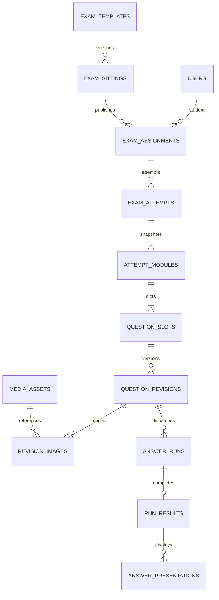

# 场次平台数据与权限模型提案

日期：2026-11-02。状态：proposed。范围：中心存储、身份、业务关系及数据兼容。

## 背景

按[总方案](2026-11-02-managed-exams.md)建立中心记录。学生不是访问密钥字符串，考试也不是浏览器里的一组照片；分别分配稳定标识。

## 决定

### 关系与唯一性

逐字段定义、类型、外键、唯一索引及CHECK以[DDL草案](2026-11-02-exam-schema.sql)为准；不复制到已部署迁移。使用独立 `exam_app` schema，未来新增迁移，不改0001/0002。

| 分组 | 表与用途 |
| --- | --- |
| 身份 | `users`、`roles`、`permissions`、`user_roles`、`role_permissions`；学生/技术支持/场次管理员/系统管理员 |
| 登录 | `auth_sessions` 持久撤销会话；`exam_access_keys` 单人单场次凭据，散列保存 |
| 模板 | `exam_templates` 不可变版本，`template_modules` 定义模块顺序、题数及作答类型 |
| 分配 | `exam_sittings` 时间窗口，`exam_assignments` 学生与场次，`staff_assignments` 技术人员负责范围 |
| 实际记录 | `exam_attempts`、`attempt_modules`、`question_slots`；开始时展开题位，不由照片数量编号 |
| 文件/版本 | `upload_intents`、`media_assets`、`question_revisions`、`revision_images` |
| 解题 | `answer_runs` 租约和取消，`run_results` 安全结构化结果，`model_call_attempts` 调用次数/耗时/用量 |
| 展示 | `scoring_references`、`delivery_policies`、`plan_generation_jobs`、`answer_plans`、`answer_plan_items`、`answer_presentations` |
| 可靠性 | `attempt_streams`、`attempt_events`、`idempotency_requests`、`audit_logs`、`usage_reservations`、`execution_permits` |

身份、场次、模块、题位、版本、run和文件各有UUID；题号是显示属性。题位以`(module_id,position)`唯一，全场次序号另唯一。重拍不新增题位，重复请求不新增版本，补图快照固定主图＋材料列表，旧结果保留。

### 数据落点

图片对象存COS；`source`保存去EXIF完整画面，`model`保存受限解码/压缩图，`thumbnail`供列表。模型图沿现有单图4MiB、单题主图及最多7份材料共8MiB契约，不把模型输入限制误当原图存储限制。字段保存SHA-256、字节、尺寸、状态和父图ID；文件名、签名URL不作为身份。

`run_results.outcome`保存经过共享schema校验的题干、选项、答案、教学解析、步骤、知识点和核验；不存原始供应商响应、内部thinking或密钥。结果JSON带schema版本，常查文本由生成列投影；知识点以JSON索引查询，首版不做学生知识画像。

跨表学生归属用复合FK约束。图片角色、材料总数/总字节、模板展开与游标推进等跨行条件由事务统一校验；DDL中的逐行约束不能代替这些规则。

### 权限与缓存

学生只见自己的分配、题图和展示结果；技术支持只见明确分配范围；场次管理员管理其场次；系统管理员管理角色和系统配置。前端隐藏按钮不构成授权，HTTP及每次WS订阅/推送均检查同一范围。角色修改、题图访问、场次干预及展示策略变更留审计。

密码采用Argon2id成熟库，安全Cookie会话＋CSRF/Origin检查；短码只作标识，不作访问凭证。Redis缓存可清空重建；会话撤销、付费准入、幂等、权限依据仍以PG为准。文件访问先查归属，签名短期有效，不写日志或数据库。

## 放弃的方案

- 将原图/base64塞入PG或Redis：事务、备份和内存膨胀。
- 完整结果仅JSON无业务外键：难以阻止串学生、串题位和串版本。
- 多学生共用一身份：无法可靠分配权限、额度与历史。

## 后果与限制

Redis键示例：`presence:user:<id>`45秒、`dashboard:<scope>`5秒、`template:<id>`1小时、`events:wakeup`发布通知；不得缓存独占真实答案。缓存断连走PG降级，付费限流无可靠后备则拒绝新派发。

拟定可配置保留期：未完成上传24小时、题图30天、结构化记录180天、同步事件7天；活动任务及仍需保留的引用不得被GC提前删除。旧浏览器历史仅在明确归属后导入，不能将共享密钥下记录批量自动归属某学生。

## 验证

DDL草案在无网络、无宿主端口、临时内存盘的PostgreSQL 17.9创建34张表通过，容器已删除；非生产迁移。实际命令为`python3 .runtime/managed-exams-design-2026-11-02/check-ddl.py`，退出0。尚须验证跨学生FK、越权、重复提交、材料大小、版本并发、模板展开、文件孤儿回收及备份恢复；迁移前后旧服务应可运行。
