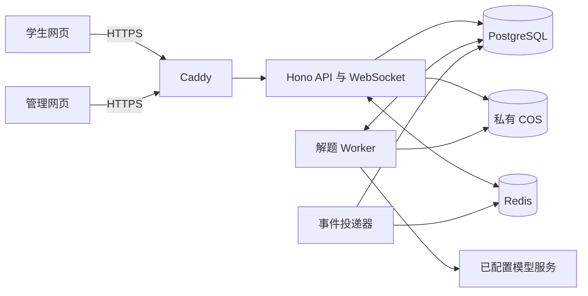

# 公网拍题场次与管理平台架构提案

日期：2026-11-02。状态：proposed。范围：`feat/public-photo-web` 学生端、管理端及中心服务；总体方案尚未全部实施或部署。

## 背景

第一阶段已部分实现，见[实施决策](../../implemented/architecture/2026-11-02-managed-exam-foundation.md)和[当前语义](../../../../docs/subsystems/managed-exams.md)；本文其余内容仍为总体提案。

用户要求按学生分配时间和考试，逐题拍照、模块推进、集中保存、实时监控及角色管理。已确认：当前题答案返回后才自动推进下一题。现有公网版已有固定模型后端，但历史在浏览器，不能承担中心记录。

已核对[公网入口](../../../../apps/photo-web/README.md)、[旧服务](../../../../docs/subsystems/legacy-server.md)、[DB schema](../../../../packages/db/src/schema.ts)和[任务仓库](../../../../packages/db/src/repository.ts)。旧路径匿名身份、图片一小时过期及每日30次限制不适用；不能仅加 WebSocket 就宣称完成。

## 决定

### 组件及职责

| 层 | 候选技术与责任 |
| --- | --- |
| 页面 | 延用 React/TypeScript，改造学生端，新增 `/admin`；主题和交互共用 |
| 接口 | 延用 Node 24/Hono，共享 contracts，HTTP负责可靠写入与补查，WebSocket通知变化 |
| 核心 | 复用 `@solveflow/agent/mobile` 当前 ACT 转录、校验和备用，提取 Node 图片适配 |
| 数据 | PostgreSQL 17 当前补丁版＋Drizzle；事务保存身份、场次、题目、答案、任务和事件 |
| 文件 | 生产采用私有腾讯云 COS/S3；库内仅元数据和引用，不存 base64 |
| 缓存 | Redis 8 受支持补丁版，缓存、限流辅助、在线状态、跨进程通知；授权与业务真相在PG |
| 执行 | API、解题 worker、事件投递器分进程；PG任务租约，Redis不承载唯一任务记录 |
| 入口 | Caddy HTTPS和反向代理；Compose一套部署，组件独立容器/持久卷 |

[PostgreSQL](https://www.postgresql.org/support/versioning/)核对日推荐17.11；沿用主版本但不照搬旧17.9镜像。[MinIO社区版已停止维护](https://www.min.io/legal)，旧本地容器不作为新生产默认。[Redis许可](https://redis.io/legal/licenses/)需随实际锁定版确认；不修改服务源码，不把缓存服务当产品转售。

业务详见[身份与数据](2026-11-02-exam-data-model.md)、[数据DDL](2026-11-02-exam-schema.sql)、[时序与接口](2026-11-02-exam-lifecycle.md)、[展示策略](2026-11-02-exam-answer-policy.md)、[界面及交付](2026-11-02-exam-ui-delivery.md)。这些是局部提案导航，不代表当前能力。

### 实施顺序

1. 共享契约、身份/RBAC、模板及场次迁移，先验越权与幂等。
2. 私有上传、不可变题图版本、持久任务、原始结果和事件事务。
3. 学生模块导航、原题重拍/补图、答案返回后推进、断线恢复。
4. 管理看板、分配范围、题目详情及统计；先读监控，再加明确授权的运维操作。
5. 版本化练习展示策略；有来源换算和失败回退，不能保证真实考试精确得分。
6. 独立环境容器、恢复演练、合成压测和获准真题验收后切换公网。

## 放弃的方案

- 复制旧匿名API或把本地库上传即上线：缺用户、场次和权限模型，过期/额度语义不符。
- Redis同时作唯一队列和事件历史：缓存丢失会影响业务恢复，与已有PG可靠任务重复。
- 首版微服务/Kubernetes：当前约12名学生，先模块化单体和独立worker，降低运维边界数量。
- 一个大容器塞入数据库和应用：升级、备份、权限及故障隔离相互绑死。

## 后果与限制

一键部署指一条命令编排多个容器，首次仍需域名、私有凭据与对象桶。单机容器不是高可用；硬件容量待12人连续大图实测。旧客户端保留独立部署，不自动把共享密钥的浏览器历史归给新学生。完整教学解析可保存，供应商内部思维链不保存或下发。

## 验证

以下为设计阶段验证记录，后续实现证据见上述实施决策。本轮为源码/官方文档调研及设计；隔离PG17.9创建34表、合成原型交互与视觉检查通过，详见子提案。未修改应用业务、执行生产迁移、调用模型或远程部署，不以原型证明新平台完成。CI全平台导出及依赖审计的已知失败需在发布前修复。
